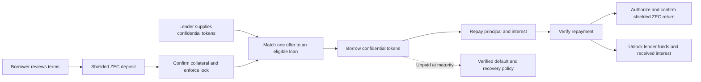
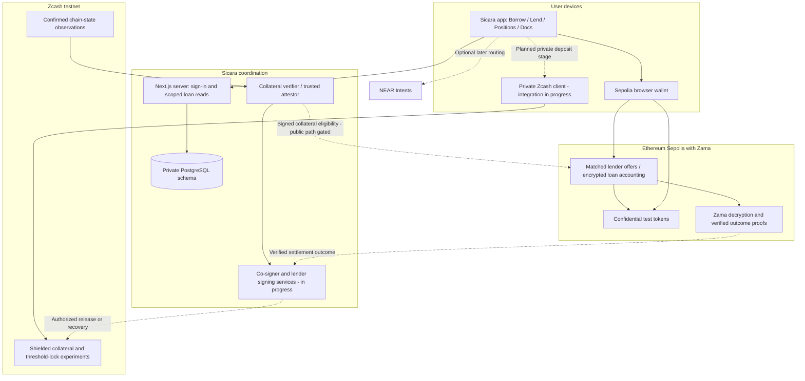
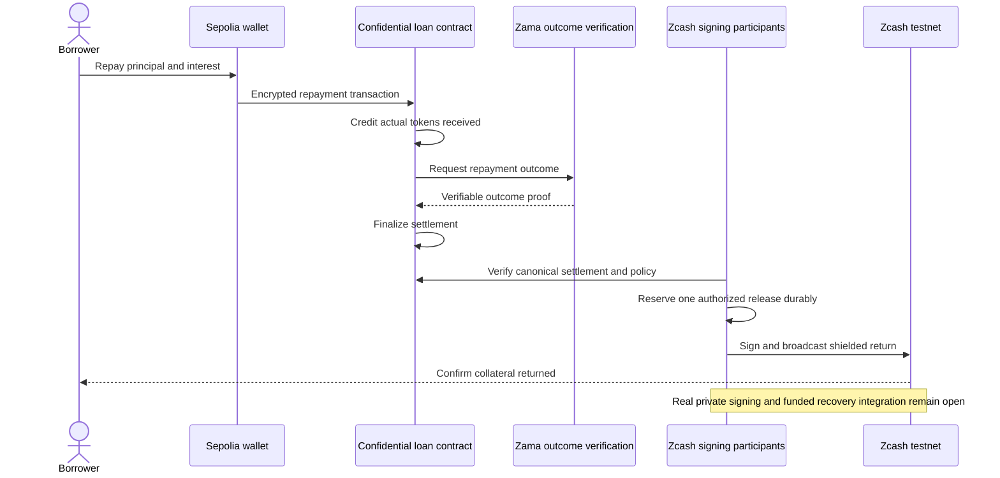

# Sicara

**Keep your ZEC. Borrow privately.**

Sicara is a lending prototype built for ZECATHON. Borrowers lock shielded ZEC to access confidential tokens on Ethereum Sepolia. Lenders supply those tokens and earn interest from repayments. Zcash protects the ZEC payment layer; Zama powers calculations on encrypted token and loan values. NEAR Intents routing is planned for later.

The original internal, operator-custodied loan completed a real testnet deposit → borrow → repay → shielded return. A separate cUSDC market has now verified live matched borrowing, full repayment and lender interest withdrawal against a freshly funded threshold deposit. Its shielded return is not yet confirmed. The newer client-held private collateral flow is still being integrated: **public ZEC deposits remain disabled**.

[Live app](https://sicara.femdev.site/) · [Watch the demo](https://youtu.be/wFmd3BxGiTw) · [How it works](#the-lending-flow) · [Architecture](#architecture) · [Run locally](#run-locally) · [Verification](#verification) · [Privacy and limits](#privacy-and-trust-boundaries)

## Start here

- **Explore the product:** run the app, open `/docs`, and visit **Borrow**, **Lend** and **Positions**. The guide explains both sides of a loan in simple terms.
- **Try the lender path:** connect a Sepolia browser wallet, get test assets from **Faucets**, then supply cUSDC. In **Positions → Supplied**, authorize private viewing or withdraw an unmatched offer.
- **Review the evidence:** the table below separates live results from local tests and unfinished integrations. A transaction receipt proves its own step, not the entire privacy design.

## What works today

| Area | Current result |
| --- | --- |
| Product interface | Compact Borrow, Lend and Positions views; `/docs` guide; browser-wallet connection; testnet faucets. Browser interaction verification is still pending. |
| Original loan pilot | Internal testnet ZEC deposit, attested confidential Demo ZAMA borrowing, repayment, and confirmed shielded return completed. Uses operator custody. |
| cUSDC lender market | Deployed on Sepolia. Small live supply, private balance verification, full unmatched withdrawal and operator-permission revocation completed. |
| Required lender interest | 2% flat term rate. A matched cUSDC loan accrued interest, repaid in full, and the lender withdrew principal plus received interest on Sepolia. |
| Persistent worker | Database-backed allocation, confirmation tracking, refunds and repayment-authorized release; restart and duplicate-send protections tested. This is the original custodial path. |
| Client-held private collateral | Real-note proof verified; fresh threshold deposit confirmed; signed timelocked default prepared; matched cUSDC borrowing, repayment and settlement verified. Shielded return and funded default/recovery remain unfinished. Roles still share one host and one approved test source. |
| Public ZEC deposits | Disabled until the private signing, chain-state and recovery gates pass. |
| NEAR and vaults | Optional later work: asset routing through NEAR Intents and reinvestment of realized lender earnings. Locked borrower ZEC stays separate. |

## The lending flow

A borrower provides ZEC collateral. A lender provides the confidential tokens the borrower receives. Repayment includes the agreed interest; collateral returns after verified repayment and a confirmed Zcash release.



This diagram describes the target complete flow. The original custodial pilot and the new private-collateral design have different trust assumptions; the latter has not completed this sequence live.

### For borrowers

1. Choose cUSDC or Demo ZAMA and review the amount, interest and deadline.
2. Once the private deposit stage is enabled, send test ZEC to the loan's validated shielded receiver.
3. Wait for confirmed collateral and lock verification, then borrow through your Sepolia wallet.
4. Repay before the deadline. Verification authorizes the return; confirmation of the Zcash transaction completes it.

The private-collateral pilot uses a **common public ceiling**: qualifying deposits support the same maximum debt without publishing each exact deposit. Principal plus interest must fit that ceiling. Prices are fixed demonstration values, not a live price oracle. Loans are fixed-term; price-based liquidation is not implemented.

### For lenders

1. Get confidential test tokens and open **Lend**.
2. Approve a short-lived token permission, then supply an offer. Each offer funds one eligible loan.
3. Use **Positions → Supplied** to view your encrypted balance and interest received. Private viewing requires wallet authorization.
4. Withdraw an unmatched offer, or wait for a matched loan's verified settlement or recovery decision.

The cUSDC market charges **2% flat per loan**, not 2% APY. For example, 0.02 borrowed cUSDC owes 0.0204 cUSDC. Interest is credited only from tokens actually repaid, after principal. It is not a guaranteed return. Lender matching and addresses are public in this version.

## Architecture

Zcash, Ethereum and NEAR are separate blockchains. Sicara does not move ZEC onto Ethereum or claim a trustless bridge. Its current approach coordinates a Zcash collateral lock with a separately funded confidential-token loan on Sepolia. A trusted attestor connects the collateral checks to the Ethereum contract; native Zcash consensus and Halo2 proofs are not verified directly by that contract.



The diagram separates the intended client-held path from the existing custodial worker. Today, the new private key roles run in an isolated local harness; separate files on one machine do not establish independent operators.

### Repayment and return



## Privacy and trust boundaries

See the [threat model](THREAT-MODEL.md) for who can learn what, signing and attestation assumptions, and remaining public-use gates.

| Layer | What it protects | What it does not establish |
| --- | --- | --- |
| Shielded Zcash payments | Payment details are hidden from public chain observers within the supported shielded pool. | A recipient with viewing authority can recognize and read received payments. Shielding alone does not lock collateral. |
| Zama confidential contracts | Supported balances, debt and realized interest use encrypted values with access controls. | Addresses, transaction timing, matching and public policy terms are not hidden. |
| Client-held collateral design | Aims to keep collateral amounts and viewing keys out of the ordinary app backend. | Full funded amount-blind signing, release and recovery are not yet established end to end. |
| Collateral attestation | Connects checked collateral eligibility to a bounded Sepolia loan. | It is a trusted verification boundary, not an on-chain Zcash light client or trustless bridge. |
| Anonymous credentials research | Investigates hiding which deposit belongs to an EVM borrower. | Deposit-to-borrower unlinkability and lender anonymity are not verified features. |

The original pilot's receiving wallet is operator-controlled, so the operator can see its received amounts and associate them with loans. The client-held redesign changes that boundary; old pilot receipts are not evidence that the redesign is complete.

Public use also requires independent chain-state agreement. Only an explicitly approved **single pinned server mode** is currently usable for isolated valueless tests. It does not satisfy the strict public gate. Client/co-signer/lender availability, non-collusion assumptions, durable records and safe deadline recovery still matter. Default activity and recovery-policy terms can be public.

## Run locally

Use **Node.js 22 LTS** and **pnpm 10.30.2**. Rust and Cargo are needed only for native Zcash services and privacy experiments.

```sh
pnpm install
pnpm fonts
pnpm dev
```

Open `http://127.0.0.1:3000`; the guide is at `/docs`. The preview and wallet connection do not need database credentials. Connect opens separate Sepolia and Zcash sections. Use MetaMask or Rabby for Sepolia; the Zcash connector supports a compatible testnet Noir extension through its documented injected RPC. It requests account authorization only, keeps the returned address in tab memory, rejects damaged/mainnet Unified Addresses and clears connection state on chain changes. It does not read balances, send payments, prove ownership or establish a loan lock. A payment QR is a separate send request. NEAR connection is not required for the current pilot.

`pnpm fonts` installs the self-hosted Satoshi font and its license from Fontshare.

For authenticated loan records, configure the server-side database variables in `.env.example`, then run `pnpm db:migrate`. Contract dependencies are installed separately with `pnpm --dir contracts install`. Keep credentials and wallet material out of source control.

## Test assets and deployed contracts

The **Faucets** entry beside Testnet provides ecosystem test resources and Sicara's capped confidential-token faucets. All assets below are valueless. **cUSDC is self-issued test currency, not Circle USDC, a reserve-backed wrapper or a redeemable dollar claim.** Demo ZAMA has no mainnet ZAMA relationship.

| Sepolia contract | Address |
| --- | --- |
| cUSDC token, 6 decimals | [`0x6060Af7f2a5D02AA4ACD1183aC7182Ff1EdFe62A`](https://sepolia.etherscan.io/address/0x6060Af7f2a5D02AA4ACD1183aC7182Ff1EdFe62A) |
| cUSDC faucet | [`0xE95D2095dA1d4aa487Dd730F8E75d1ED80049CC1`](https://sepolia.etherscan.io/address/0xE95D2095dA1d4aa487Dd730F8E75d1ED80049CC1) |
| cUSDC matched lender market | [`0x9f64452Cee00181BaFB52900DA691c71b4bd2E78`](https://sepolia.etherscan.io/address/0x9f64452Cee00181BaFB52900DA691c71b4bd2E78) |

The market has fixed deployment-wide repayment and settlement cutoffs. Its UI reads the live terms and refuses new supply after the repayment cutoff; it is not a permanent rolling market. Demo ZAMA remains a supported demo asset, but a second matched lender market is not configured.

### Recorded live evidence — 2026-10-28

| Check | Receipt | Scope |
| --- | --- | --- |
| Shielded deposit | Zcash testnet transaction `07997f02dac4f4b339e50cca2bc7a55e56feb9dfa6a8d9b6ebfba23b143c77da` | Original internal custodial pilot. |
| Confidential borrowing | [Sepolia borrow](https://sepolia.etherscan.io/tx/0xb5bd7b116f3e5c44a7edf0861b3f1d119f84f1525e38310dc0fb57312f6707d3) | Original internal Demo ZAMA custodial pilot. |
| Repayment | [Sepolia repayment](https://sepolia.etherscan.io/tx/0x558e01d7df6b6faf70653e83a5ea6f5c4455d2a30ee493697246d7d27abec05f) | Same pilot; settlement and recipient return were verified in local evidence. |
| Shielded return | Zcash testnet transaction `a481e0eda19aaddb9ff1b6f83bf99a34647d029feeda0ca5e8d1d392b46121fa` | Same pilot; independently checked recipient receipt with 18 confirmations. Completes the original custodial loop. |
| Threshold test deposit | Zcash testnet transaction `2a1ddd1a4df316987108524d7b684e1fe0483858f6716a210dfa0b964bc6b8dd` | Fresh threshold receivers confirmed; real-note default signed with a live maturity. One-host, explicitly trusted single-server test. |
| Matched cUSDC borrowing | [Confidential draw](https://sepolia.etherscan.io/tx/0x9add18709f398a9b3e6e6c3f688b73f6a29e37cadcd13ba44c1c6e66e833b97a) | New threshold-collateral experiment; private debt verified including interest. |
| Matched cUSDC repayment | [Full repayment](https://sepolia.etherscan.io/tx/0x2cbfe1e017f88b3452785b38446bbf7c3af1c698599a789035b34dff83851e4b), [KMS settlement](https://sepolia.etherscan.io/tx/0x236a6e994b14784e0be9071397ae2f71e425f18804fdc70750a8d9fe22c88634) | Zero debt verified and settlement finalized. This does not establish a confirmed Zcash return. |
| Lender principal and interest | [Matched-position withdrawal](https://sepolia.etherscan.io/tx/0xde8d6f985206c0d5fabf4341c7947f5876a7bd122d879151eb09f5ec3dd1416d) | Private earned/available accounting verified before withdrawal; position returned to zero. |
| Real-note proof | Confirmed note membership at anchor height **4,552,335**; **5,024-byte proof** verified in a separate native process | Ordinary fresh-wallet funding note, using an explicitly trusted single test server. Does not establish a current unspent note, threshold lock or borrowing authorization. |
| Lender supply | [cUSDC supply](https://sepolia.etherscan.io/tx/0xc3f1b7f6c5040d8ad06a020258e7142c7e9d41ac6ab861c94669d608004f12c8) | Actual unmatched supply; its private position balance was verified. |
| Lender withdrawal | [Full withdrawal](https://sepolia.etherscan.io/tx/0x5748d6c42aabf29f68e08542ae0093db074fd14bfc77f72aba4dea0b8e03f431) | Position returned to zero; temporary token permission was subsequently revoked. |

Private wallet files and detailed local evidence are intentionally excluded from publication. These receipts do not prove a completed client-held collateral return/default/recovery flow or anonymous borrower association.

### Frontend scope

The completed custodial loop was exercised through internal scripts and workers, not a complete browser walkthrough. The frontend currently supports loan previews and terms, wallet account connection, faucets, and cUSDC lender supply/private viewing/unmatched withdrawal controls. New public borrowing still stops at review. For a wallet with an already approved cUSDC loan, Positions → Borrowed now provides private debt viewing, one-time borrowing, full repayment and KMS settlement controls. These controls pass typecheck/build checks but have not completed browser interaction verification. The private deposit client and confirmed collateral-return stages are not connected end to end in the public UI. Browser interaction verification remains pending, including the lender controls. Passing builds and unit tests do not replace that check.

## Verification

```sh
pnpm lint
pnpm typecheck
pnpm test
pnpm build
pnpm --dir contracts typecheck
pnpm --dir contracts test
```

Latest local checks: **57 app tests pass**; **28 contract tests pass** in the default run, with one native binding integration skipped unless its local binary is configured. Running that integration separately with the native binary passes both binding tests. Root and contract typechecks pass. The app production build passes, with a webpack chunk-cycle warning from the confidential-token SDK integration. Browser interaction verification remains pending.

App tests cover exact amount math, authenticated reads, real PostgreSQL migrations, ownership, confirmations, reservations, refunds, restarts and release coordination. Contract tests cover encrypted transfers, access controls, replay protection, repayment, settlement, lender fund isolation and required interest. Native proof tests over synthetic roots are not live collateral evidence.

## Repository map

```text
src/app/                    Pages, /docs and authenticated API routes
src/components/             Shared layout, dialogs, brand and controls
src/features/lending/       Borrowing UI, terms, positions and loan records
src/features/liquidity/     Lender supply, private position viewing and withdrawal
src/features/privacy/       Browser-side confidential input and viewing helpers
src/features/wallet/        Sepolia connection and server-side sign-in
src/features/zcash/         Zcash connection, local QR and payment requests
src/features/test-funds/    Ecosystem and confidential-token faucet UI
services/database/          PostgreSQL adapters and versioned migrations
services/zcash/             Native validator, sidecar adapter, journals and worker
contracts/                  Confidential tokens, lending contracts and tests
tests/                      App, database and worker checks
```

Routes compose features; feature modules own their domain logic. Shared UI stays separate from loan and wallet rules. Styling uses Tailwind, Satoshi and Phosphor filled icons. GSAP handles a small entrance animation with reduced-motion support.

## Roadmap

Complete and verify the client-held collateral return, funded default/recovery and complete browser/client journey before opening public ZEC deposits. Live matched cUSDC repayment and lender interest withdrawal are verified. Borrower-to-deposit unlinkability remains separate privacy work.

NEAR Intents routing and lender-earnings reinvestment are later extensions. Borrowers’ locked ZEC stays separate from yield strategies.

## Built with and acknowledgments

- **Zcash:** [librustzcash](https://github.com/zcash/librustzcash), its wallet and protocol crates, shielded payments and note proofs are the collateral foundation.
- **Zama:** [FHEVM tooling](https://github.com/zama-ai/fhevm-hardhat-template), the Relayer SDK and OpenZeppelin confidential contracts support encrypted token operations. The pinned SDK version matches the tested contract toolchain; revalidate compatibility before upgrading.
- **Silicr:** [upstream project](https://github.com/mrnetwork0001/Silicr), pinned at `0767b30f645be6e7083c1f4e3cb01c19728f1ef9`, provides the prepared wallet sidecar and informed the local ZIP 321 payment flow. The isolated funding build applies Sicara's testnet budget patch. Preserve upstream license and attribution notices.
- **NEAR:** [NEAR Intents](https://docs.near-intents.org/) is the planned optional routing layer; it does not verify collateral or replace Zcash privacy.
- **Noir Wallet:** [injected provider reference](https://github.com/NoirWallet/zcash-wallet-adapter) informed the testnet account connector. Wallet connection does not establish Sicara’s private collateral lock.
- **Interface:** Next.js, React, Tailwind, wagmi, viem, Satoshi and Phosphor. Superbridge informed the visual direction; Sicara's layout is designed for lending.

Sicara is an independent prototype. Its test tokens are not endorsed by Circle or Zama. Third-party components retain their own licenses; this checkout does not declare a project-wide open-source license.
