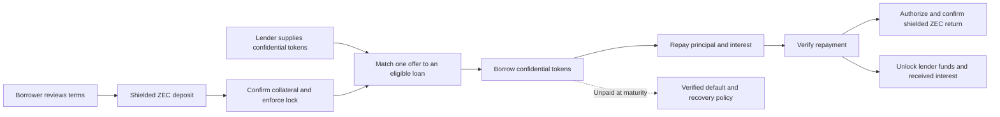
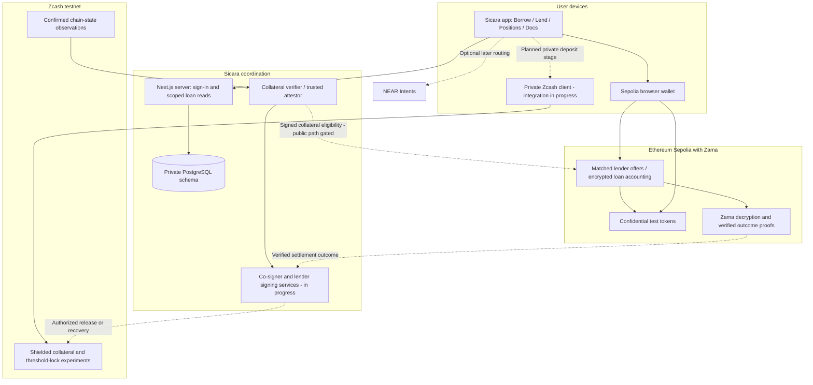
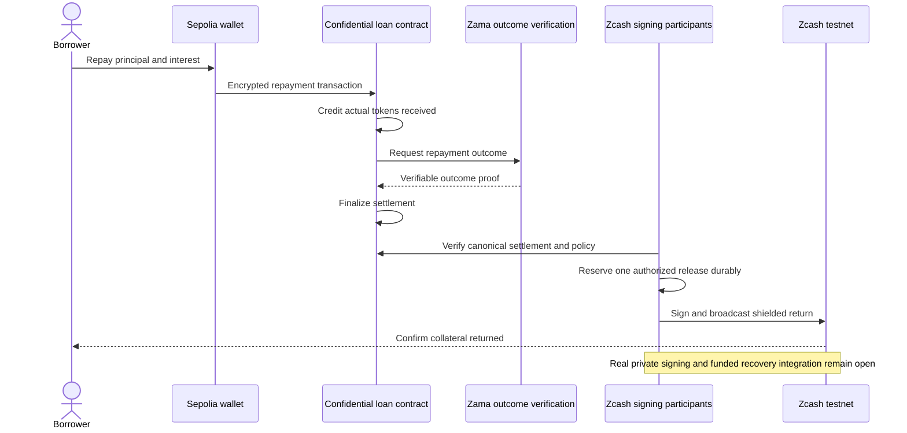

# Sicara

**Keep your ZEC. Borrow privately.**

Sicara is a lending prototype built for ZECATHON. Borrowers lock shielded ZEC to access confidential tokens on Ethereum Sepolia. Lenders supply those tokens and earn interest from repayments. Zcash protects the ZEC payment layer; Zama powers calculations on encrypted token and loan values. NEAR Intents routing is planned for later.

**Testnet only · Experimental · Unaudited**

The original internal, operator-custodied loan completed a real testnet deposit → borrow → repay → shielded return. A separate cUSDC lender market now supports verified live supply and withdrawal. The newer client-held private collateral flow is still being integrated: **public ZEC deposits remain disabled**.

[How it works](#the-lending-flow) · [Architecture](#architecture) · [Run locally](#run-locally) · [Verification](#verification) · [Privacy and limits](#privacy-and-trust-boundaries)

## Start here

- **Explore the product:** run the app, open `/docs`, and visit **Borrow**, **Lend** and **Positions**. The guide explains both sides of a loan in simple terms.
- **Try the lender path:** connect a Sepolia browser wallet, get test assets from **Faucets**, then supply cUSDC. In **Positions → Supplied**, authorize private viewing or withdraw an unmatched offer.
- **Review the evidence:** the table below separates live results from local tests and unfinished integrations. A transaction receipt proves its own step, not the entire privacy design.

No public deployment URL is supplied in this checkout. The local app runs at `http://127.0.0.1:3000`.

## What works today

| Area | Current result |
| --- | --- |
| Product interface | Compact Borrow, Lend and Positions views; `/docs` guide; browser-wallet connection; testnet faucets. Browser interaction verification is still pending. |
| Original loan pilot | Internal testnet ZEC deposit, attested confidential Demo ZAMA borrowing, repayment, and confirmed shielded return completed. Uses operator custody. |
| cUSDC lender market | Deployed on Sepolia. Small live supply, private balance verification, full unmatched withdrawal and operator-permission revocation completed. |
| Required lender interest | Encrypted accounting implemented with a 2% flat term rate. Local tests verify repayment allocation and withdrawal of principal plus received interest. Live matched-loan interest delivery is not yet demonstrated. |
| Persistent worker | Database-backed allocation, confirmation tracking, refunds and repayment-authorized release; restart and duplicate-send protections tested. This is the original custodial path. |
| Client-held private collateral | Native note proofs, threshold lock/release experiments, durable signing records and fresh funded scanning exist. The complete funded release/default/recovery runner remains unfinished. |
| Public ZEC deposits | Disabled until the private signing, chain-state and recovery gates pass. |
| NEAR and vaults | Optional later work: asset routing through NEAR Intents and reinvestment of realized lender earnings. Locked borrower ZEC stays separate. |

## The lending flow

A borrower provides ZEC collateral. A lender provides the confidential tokens the borrower receives. Repayment includes the agreed interest; collateral returns after verified repayment and a confirmed Zcash release.



This diagram describes the target complete flow. The original custodial pilot and the new private-collateral design have different trust assumptions; the latter has not completed this sequence live.

### For borrowers

1. Choose cUSDC or Demo ZAMA and review the amount, interest and deadline.
2. Once the private deposit stage is enabled, send test ZEC to the loan's validated shielded receiver.
3. Wait for confirmed collateral and lock verification, then borrow through your Sepolia wallet.
4. Repay before the deadline. Verification authorizes the return; confirmation of the Zcash transaction completes it.

The private-collateral pilot uses a **common public ceiling**: qualifying deposits support the same maximum debt without publishing each exact deposit. Principal plus interest must fit that ceiling. Prices are fixed demonstration values, not a live price oracle. Loans are fixed-term; price-based liquidation is not implemented.

### For lenders

1. Get confidential test tokens and open **Lend**.
2. Approve a short-lived token permission, then supply an offer. Each offer funds one eligible loan.
3. Use **Positions → Supplied** to view your encrypted balance and interest received. Private viewing requires wallet authorization.
4. Withdraw an unmatched offer, or wait for a matched loan's verified settlement or recovery decision.

The cUSDC market charges **2% flat per loan**, not 2% APY. For example, 0.02 borrowed cUSDC owes 0.0204 cUSDC. Interest is credited only from tokens actually repaid, after principal. It is not a guaranteed return. Lender matching and addresses are public in this version.

## Architecture

Zcash, Ethereum and NEAR are separate blockchains. Sicara does not move ZEC onto Ethereum or claim a trustless bridge. Its current approach coordinates a Zcash collateral lock with a separately funded confidential-token loan on Sepolia. A trusted attestor connects the collateral checks to the Ethereum contract; native Zcash consensus and Halo2 proofs are not verified directly by that contract.



The diagram separates the intended client-held path from the existing custodial worker. Today, the new private key roles run in an isolated local harness; separate files on one machine do not establish independent operators.

### Repayment and return



## Privacy and trust boundaries

| Layer | What it protects | What it does not establish |
| --- | --- | --- |
| Shielded Zcash payments | Payment details are hidden from public chain observers within the supported shielded pool. | A recipient with viewing authority can recognize and read received payments. Shielding alone does not lock collateral. |
| Zama confidential contracts | Supported balances, debt and realized interest use encrypted values with access controls. | Addresses, transaction timing, matching and public policy terms are not hidden. |
| Client-held collateral design | Aims to keep collateral amounts and viewing keys out of the ordinary app backend. | Full funded amount-blind signing, release and recovery are not yet established end to end. |
| Collateral attestation | Connects checked collateral eligibility to a bounded Sepolia loan. | It is a trusted verification boundary, not an on-chain Zcash light client or trustless bridge. |
| Anonymous credentials research | Investigates hiding which deposit belongs to an EVM borrower. | Deposit-to-borrower unlinkability and lender anonymity are not verified features. |

The original pilot's receiving wallet is operator-controlled, so the operator can see its received amounts and associate them with loans. The client-held redesign changes that boundary; old pilot receipts are not evidence that the redesign is complete.

Public use also requires independent chain-state agreement. Only an explicitly approved **single pinned server mode** is currently usable for isolated valueless tests. It does not satisfy the strict public gate. Client/co-signer/lender availability, non-collusion assumptions, durable records and safe deadline recovery still matter. Default activity and recovery-policy terms can be public.

## Run locally

Use **Node.js 22 LTS** and **pnpm 10.30.2**. Rust and Cargo are needed only for native Zcash services and privacy experiments.

```sh
pnpm install
pnpm fonts
pnpm dev
```

Open `http://127.0.0.1:3000`; the guide is at `/docs`. The preview and wallet connection do not need database credentials. Use a Sepolia browser wallet such as MetaMask or Rabby. Zcash payments use a separate testnet wallet; a payment QR is a send request, not a wallet login. NEAR connection is not required for the current pilot.

`pnpm fonts` installs the self-hosted Satoshi font and its license from Fontshare. Stop the development server with Ctrl-C when finished.

### Database and sign-in

Copy `.env.example` into a local `.env.local` **only if that file does not already exist**, then configure:

| Variable | Purpose |
| --- | --- |
| `DATABASE_URL` | Supabase PostgreSQL transaction pooler for app requests. |
| `DATABASE_MIGRATION_URL` | Direct or session connection for migrations. |
| `DATABASE_WORKER_URL` | Dedicated session connection for the persistent worker; transaction pooling is unsuitable for its lock. |
| `DATABASE_SSL_CA_FILE` | Optional CA path for verified TLS; `.local/supabase-ca.crt` is used when present. |
| `SICARA_APP_ORIGIN` | Exact browser origin; local default is `http://127.0.0.1:3000`. |

Use the PostgreSQL connection strings from Supabase's **Connect** panel, with an encoded password and verified TLS. No browser Supabase API key is required. See [Supabase connection options](https://supabase.com/docs/guides/database/connecting-to-postgres).

```sh
pnpm db:migrate
```

The runner applies pending migrations transactionally. Then connect a Sepolia wallet, open **Positions → Borrowed**, and explicitly sign in to read that wallet's loan requests. Connecting alone does not request a signature. The first sign-in implementation supports EOAs, not contract-wallet signatures.

### Contracts and native services

The Hardhat package is separate from the app. Use Node 22 for these commands:

```sh
pnpm --dir contracts install
pnpm --dir contracts compile
pnpm --dir contracts typecheck
pnpm --dir contracts test
```

Live contract tools use `contracts/.env`, following `contracts/.env.example`: `SEPOLIA_RPC_URL` and a dedicated test-only `SEPOLIA_PRIVATE_KEY`. Keep keys out of source control and chat. Deployment and live scripts send transactions; they are not part of the default local setup.

The original custodial worker is also separate from Next.js:

```sh
pnpm zcash:prepare
pnpm zcash:validator
pnpm worker --once
```

Configure the protected wallet paths from `.env.example` on the custody host first. `--once` performs one reconciliation pass and closes resources; it can process existing authorized work. Preserve the wallet, database and write-ahead journals together. Never reset wallet state to resolve a sync error, expose the wallet process publicly, or enable public intake by bypassing the privacy gates.

## Deploy the app on Vercel

You can deploy the web app now while public ZEC deposits stay gated. Supabase hosts the database. The persistent Zcash wallet, worker and signing services require a separate persistent host; they are not deployed by Vercel. Existing Sepolia contracts do not need redeploying for a website deployment.

1. Commit and push the latest app changes to your existing repository. The repository may remain private; grant the Vercel GitHub integration access to it.
2. In Vercel, choose **Add New → Project**, import that repository and select **Next.js**. Use the directory containing this `package.json` as the root, normally `./` for a Sicara-only repository.
3. Use Node **22.x**. The included `vercel.json` installs with `pnpm install --frozen-lockfile` and builds with `pnpm fonts && pnpm build`; leave the output directory at the Next.js default. Font downloading is required because font binaries are not committed.
4. Add the production environment values below. Do not upload the whole local environment file.
5. Deploy. If the final domain was not known beforehand, set `SICARA_APP_ORIGIN` to the resulting stable production URL, then redeploy. Environment changes apply to new deployments.
6. Open `/` and `/docs`, connect on Sepolia, then verify sign-in in **Positions → Borrowed**. Check the cUSDC faucet, supply and unmatched withdrawal using small test amounts. A successful build alone does not verify browser encryption or wallet prompts.

| Vercel environment variable | Value |
| --- | --- |
| `DATABASE_URL` | Your existing Supabase app transaction-pooler connection string, normally port 6543. Keep the password private, URL-encode it, retain verified TLS and remove any Mac-only `sslrootcert` path. |
| `SICARA_APP_ORIGIN` | Exact production origin, such as `https://your-actual-project.vercel.app`, with no trailing slash. It must match the domain opened in the browser. |
| `DATABASE_SSL_CA` | If the database needs the Supabase CA, paste its complete **public** PEM certificate, including BEGIN/END lines. Actual newlines or literal `\n` escapes work. Obtain it from the project's database SSL settings; the current local copy is `.local/supabase-ca.crt`. |

Keep `DATABASE_MIGRATION_URL`, `DATABASE_WORKER_URL`, `DATABASE_SSL_CA_FILE`, wallet paths, seeds, key shares and `SEPOLIA_PRIVATE_KEY` off Vercel. They belong on the appropriate local/admin/worker host. Run `pnpm db:migrate` locally against the hosted database when needed; do not run migrations during every Vercel build. There are no required `NEXT_PUBLIC_*` secrets or Supabase anon/service-role keys for this app.

Production and Preview are separate environments. Use the stable production domain for submission and wallet sign-in; a preview URL will not match a production-only origin setting. If Vercel enables deployment protection, make sure judges can access the submitted production URL without signing into your Vercel account.

SEO uses the configured production origin for canonical URLs, Open Graph/Twitter previews, `/robots.txt` and `/sitemap.xml`. Only the public home and guide pages enter the sitemap; API routes are excluded. HTTPS production deployments can be indexed; local and Vercel preview builds remain noindex. The branded social card is rendered locally as a PNG, and the home page includes SoftwareApplication structured data without invented ratings or endorsements.

References: [Vercel Git imports](https://vercel.com/docs/git), [Node versions](https://vercel.com/docs/functions/runtimes/node-js/node-js-versions), [environment variables](https://vercel.com/docs/environment-variables), [function runtime limits](https://vercel.com/docs/functions/runtimes).

## Test assets and deployed contracts

The **Faucets** entry beside Testnet provides ecosystem test resources and Sicara's capped confidential-token faucets. All assets below are valueless. **cUSDC is self-issued test currency, not Circle USDC, a reserve-backed wrapper or a redeemable dollar claim.** Demo ZAMA has no mainnet ZAMA relationship.

| Sepolia contract | Address |
| --- | --- |
| cUSDC token, 6 decimals | [`0x6060Af7f2a5D02AA4ACD1183aC7182Ff1EdFe62A`](https://sepolia.etherscan.io/address/0x6060Af7f2a5D02AA4ACD1183aC7182Ff1EdFe62A) |
| cUSDC faucet | [`0xE95D2095dA1d4aa487Dd730F8E75d1ED80049CC1`](https://sepolia.etherscan.io/address/0xE95D2095dA1d4aa487Dd730F8E75d1ED80049CC1) |
| cUSDC matched lender market | [`0x9f64452Cee00181BaFB52900DA691c71b4bd2E78`](https://sepolia.etherscan.io/address/0x9f64452Cee00181BaFB52900DA691c71b4bd2E78) |

The market has fixed deployment-wide repayment and settlement cutoffs. Its UI reads the live terms and refuses new supply after the repayment cutoff; it is not a permanent rolling market. Demo ZAMA remains a supported demo asset, but a second matched lender market is not configured.

### Recorded live evidence — 2026-10-28

| Check | Receipt | Scope |
| --- | --- | --- |
| Confidential borrowing | [Sepolia borrow](https://sepolia.etherscan.io/tx/0xb5bd7b116f3e5c44a7edf0861b3f1d119f84f1525e38310dc0fb57312f6707d3) | Original internal Demo ZAMA custodial pilot. |
| Repayment | [Sepolia repayment](https://sepolia.etherscan.io/tx/0x558e01d7df6b6faf70653e83a5ea6f5c4455d2a30ee493697246d7d27abec05f) | Same pilot; settlement and recipient return were verified in local evidence. |
| Lender supply | [cUSDC supply](https://sepolia.etherscan.io/tx/0xc3f1b7f6c5040d8ad06a020258e7142c7e9d41ac6ab861c94669d608004f12c8) | Actual unmatched supply; its private position balance was verified. |
| Lender withdrawal | [Full withdrawal](https://sepolia.etherscan.io/tx/0x5748d6c42aabf29f68e08542ae0093db074fd14bfc77f72aba4dea0b8e03f431) | Position returned to zero; temporary token permission was subsequently revoked. |

Private wallet files and detailed local evidence are intentionally excluded from publication. These receipts do not prove a completed client-held collateral loan, live interest payment or anonymous borrower association.

## Verification

```sh
pnpm lint
pnpm typecheck
pnpm test
pnpm build
pnpm --dir contracts typecheck
pnpm --dir contracts test
```

Latest local checks: **54 app tests pass**; **28 contract tests pass** in the default run, with one native binding integration skipped unless its local binary is configured. Running that integration separately with the native binary passes both binding tests. Root and contract typechecks pass. The app production build passes, with a webpack chunk-cycle warning from the confidential-token SDK integration. Browser interaction verification remains pending.

App tests cover exact amount math, authenticated reads, real PostgreSQL migrations, ownership, confirmations, reservations, refunds, restarts and release coordination. Contract tests cover encrypted transfers, access controls, replay protection, repayment, settlement, lender fund isolation and required interest. Native proof tests over synthetic roots are not live collateral evidence.

## Repository map

```text
src/app/                    Pages, /docs and authenticated API routes
src/components/             Shared layout, dialogs, brand and controls
src/features/lending/       Borrowing UI, terms, positions and loan records
src/features/liquidity/     Lender supply, private position viewing and withdrawal
src/features/privacy/       Browser-side confidential input and viewing helpers
src/features/wallet/        Sepolia connection and server-side sign-in
src/features/zcash/         Local payment QR and ZIP 321 request helpers
src/features/test-funds/    Ecosystem and confidential-token faucet UI
services/database/          PostgreSQL adapters and versioned migrations
services/zcash/             Native validator, sidecar adapter, journals and worker
contracts/                  Confidential tokens, lending contracts and tests
tests/                      App, database and worker checks
```

Routes compose features; feature modules own their domain logic. Shared UI stays separate from loan and wallet rules. Styling uses Tailwind, Satoshi and Phosphor filled icons. GSAP handles a small entrance animation with reduced-motion support. The film project, private product notes, local privacy experiments, keys and generated evidence are excluded by `.gitignore`; experimental script entries require the owner's local research files.

## Remaining core work

1. Connect real per-loan client, co-signer and lender signing sessions to durable policy checks.
2. Complete the funded repayment/release, default and recovery scenarios using confirmed Zcash state.
3. Satisfy independent chain-state verification for public use and validate the deadline/recovery behavior.
4. Connect the private borrower lifecycle to the UI, verify browser interactions and demonstrate live matched lender interest delivery.
5. Enable public testnet ZEC deposits only after those gates pass.

NEAR Intents routing and verified-vault reinvestment follow the core flow. Lender interest is required core functionality, not an optional extension.

## Built with and acknowledgments

- **Zcash:** [librustzcash](https://github.com/zcash/librustzcash), its wallet and protocol crates, shielded payments and note proofs are the collateral foundation.
- **Zama:** [FHEVM tooling](https://github.com/zama-ai/fhevm-hardhat-template), the Relayer SDK and OpenZeppelin confidential contracts support encrypted token operations. The pinned SDK version matches the tested contract toolchain; revalidate compatibility before upgrading.
- **Silicr:** [upstream project](https://github.com/mrnetwork0001/Silicr), pinned at `0767b30f645be6e7083c1f4e3cb01c19728f1ef9`, provides the prepared wallet sidecar and informed the local ZIP 321 payment flow. The isolated funding build applies Sicara's testnet budget patch. Preserve upstream license and attribution notices.
- **NEAR:** [NEAR Intents](https://docs.near-intents.org/) is the planned optional routing layer; it does not verify collateral or replace Zcash privacy.
- **Interface:** Next.js, React, Tailwind, wagmi, viem, Satoshi and Phosphor. Superbridge informed the visual direction; Sicara's layout is designed for lending.

Sicara is an independent prototype. Its test tokens are not endorsed by Circle or Zama. Third-party components retain their own licenses; this checkout does not declare a project-wide open-source license.
